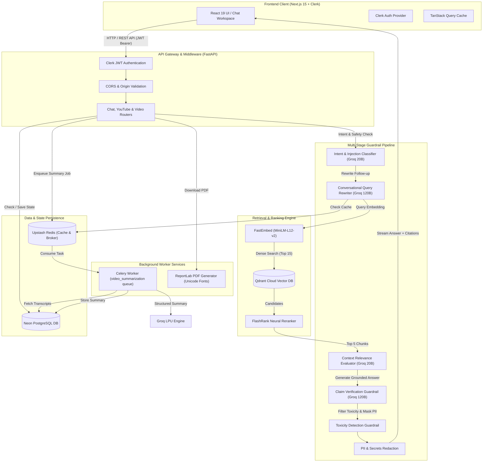
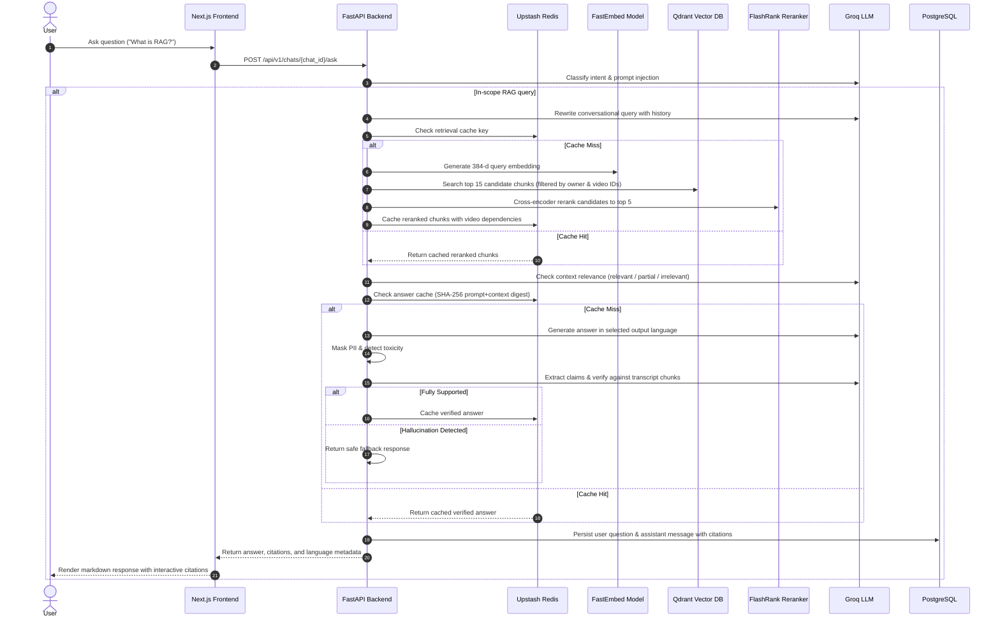

<div align="center">

# 🎥 YouTube RAG Bot

**Production-grade, multilingual Retrieval-Augmented Generation (RAG) platform for interactive YouTube video question-answering, multi-video contextual analysis, asynchronous summarization, and PDF report generation.**

[](https://fastapi.tiangolo.com/)
[](https://nextjs.org/)
[](https://react.dev/)
[](https://tailwindcss.com/)
[](https://neon.tech/)
[](https://qdrant.tech/)
[](https://upstash.com/)
[](https://docs.celeryq.dev/)
[](https://clerk.com/)
[](https://groq.com/)

[Live Demo](#screenshots--demo) • [System Architecture](#system-architecture) • [RAG Pipeline](#rag-workflow) • [API Documentation](#api-documentation) • [Setup Guide](#installation--setup)

</div>

---

## 📌 Table of Contents

- [Project Overview](#project-overview)
- [Key Features](#key-features)
- [Tech Stack](#tech-stack)
- [System Architecture](#system-architecture)
- [RAG Workflow](#rag-workflow)
- [Guardrails & Safety Pipeline](#guardrails--safety-pipeline)
- [Project Structure](#project-structure)
- [Installation & Setup](#installation--setup)
- [Environment Variables](#environment-variables)
- [API Documentation](#api-documentation)
- [Evaluation & Benchmarks](#evaluation--benchmarks)
- [Screenshots / Demo](#screenshots--demo)
- [Future Improvements](#future-improvements)
- [Author & Contact](#author--contact)

---

## 📖 Project Overview

**YouTube RAG Bot** is a full-stack, enterprise-ready AI application that turns any YouTube video into an interactive, conversational knowledge base. By combining dense semantic search, neural reranking, deterministic guardrails, multi-tenant isolation, and background distributed workers, the system delivers grounded, factual answers with timestamped source citations across 7 languages.

Unlike naive RAG wrappers, this platform implements a resilient end-to-end architecture featuring:
- **Two-tier caching** (retrieval cache with video version invalidation and answer caching).
- **Multi-stage guardrail defenses** (prompt-injection detection, PII masking, toxicity filtering, context relevance evaluation, and claim-level hallucination verification).
- **Asynchronous video summarization** with atomic job claims and multilingual PDF report generation using Unicode font embedding.
- **Built-in evaluation harness** with test suites measuring Precision@K, Recall@K, MRR, Faithfulness, and Answer Relevance against verified Qdrant ground-truth data.

---

## ✨ Key Features

| Capability | Engineering Implementation |
| :--- | :--- |
| **YouTube Transcript Ingestion** | Fetches native transcripts via `youtube-transcript-api` with automatic fallback to audio extraction via `yt-dlp` and Whisper transcription. Normalizes multilingual text and chunks with semantic overlap. |
| **Multilingual Vector Embeddings** | Vectorizes transcript chunks using FastEmbed (`sentence-transformers/paraphrase-multilingual-MiniLM-L12-v2`, 384 dimensions) and indexes them into Qdrant Cloud collections with user/video payload filtering. |
| **Two-Stage Retrieval & Neural Reranking** | Executes high-recall vector search ($K=15$) on Qdrant, followed by neural cross-encoder reranking using FlashRank (`ms-marco-TinyBERT-L-2-v2`) to select the top 5 most relevant context passages. |
| **Conversational Context Rewriting** | Resolves pronoun references and conversational follow-ups by rewriting questions into standalone retrieval queries using Groq LLM inference. |
| **Multi-Stage Guardrail Pipeline** | 5-layer safety architecture: 1) Intent classification & prompt-injection detection; 2) Context relevance check; 3) PII & credential redaction; 4) Toxicity detection; 5) Claim-level hallucination verification. |
| **Multi-User Multi-Chat Architecture** | Multi-tenant isolation enforced at the PostgreSQL and vector payload layers. Users can create multiple chats, associate multiple videos per chat, and manage chat titles and output languages independently. |
| **Multilingual Synthesis (7 Languages)** | Supports question-answering and structured summaries in English, Hindi, Punjabi, Spanish, French, German, and Japanese with technical terminology preservation. |
| **Distributed Summaries & PDF Export** | Celery background workers with Upstash Redis broker execute async structured summarization (summary, key points, topics) and generate downloadable ReportLab PDFs with Unicode CJK/Indic font support. |
| **Two-Tier Redis Caching** | Upstash Redis caches retrieval results with video dependency mapping for automatic cache invalidation upon video updates, and caches verified answers using deterministic SHA-256 prompt-context digests. |
| **RAG Evaluation Harness** | Diagnostic and regression testing suite evaluating retrieval (Precision@K, Recall@K, MRR) and generation (Faithfulness claim-ratio, Answer Relevance) with bounded exponential backoff against Groq 429 rate limits. |

---

## 🛠 Tech Stack

### Frontend
- **Framework:** Next.js 15 (App Router, React 19)
- **Language:** JavaScript (ES6+ / JSX)
- **Styling:** Tailwind CSS, PostCSS, `@tailwindcss/typography`
- **State & Data Fetching:** TanStack React Query v5 (optimistic updates, query caching)
- **Authentication:** Clerk Next.js SDK (`@clerk/nextjs`)
- **Icons & UI:** Lucide React, React Markdown, Remark GFM
- **Forms & Validation:** React Hook Form, Zod

### Backend
- **Framework:** FastAPI (Python 3.12, Uvicorn, ASGI)
- **Database ORM:** SQLAlchemy 2.0, Alembic database migrations
- **Relational Database:** PostgreSQL (Neon Serverless with connection pooling)
- **Vector Database:** Qdrant Cloud (Cosine metric, 384-dimensional dense vectors)
- **Embeddings:** FastEmbed (`sentence-transformers/paraphrase-multilingual-MiniLM-L12-v2`)
- **Neural Reranker:** FlashRank (`ms-marco-TinyBERT-L-2-v2`)
- **LLM Engine:** Groq API (`openai/gpt-oss-120b` for generation/verification, `openai/gpt-oss-20b` for classification)
- **Distributed Tasks:** Celery with Redis broker and result backend
- **Caching:** Upstash Redis (SSL/TLS encrypted)
- **PDF Generation:** ReportLab 4.4+ with HarfBuzz text shaping (`uharfbuzz`, `fonttools`) and TrueType/OpenType font loading

---

## 🏗 System Architecture



---

## 🔄 RAG Workflow

The core retrieval and answer generation pipeline consists of 6 discrete phases:



### 1. Ingestion & Preprocessing
- Accepts YouTube video URLs (standard, shortened, and playlist links).
- Extracts transcript blocks with exact millisecond timestamps.
- When native subtitles are unavailable, downloads audio streams via `yt-dlp` and transcribes using Whisper.
- Generates 384-dimensional dense embeddings with FastEmbed and stores vectors in Qdrant with payload attributes: `owner_id`, `video_id`, `youtube_video_id`, `video_title`, `start`, `end`, and `text`.

### 2. Retrieval & Neural Reranking
- Filters vector search strictly to videos currently attached to the user's active chat session.
- Performs cosine similarity candidate retrieval ($K = 15$).
- Reranks candidate passages using FlashRank (`ms-marco-TinyBERT-L-2-v2`), prioritizing semantic relevance over raw vector similarity to select the top 5 chunks.

### 3. Answer Generation & Citation Tracking
- Synthesizes grounded answers strictly from retrieved context chunks.
- Maps chunk timestamps into clickable source citations with original similarity scores and reranking relevance scores.
- Formats markdown responses adhering to the requested target language without losing technical terms.

---

## 🛡 Guardrails & Safety Pipeline

The application features a defense-in-depth safety architecture:

```
User Query ──► [1. Intent & Injection Classifier] ──► [2. Query Rewriter] ──► [3. Context Relevance]
                                                                                     │
Response ◄── [6. Claim Verification] ◄── [5. Toxicity] ◄── [4. PII Redaction] ◄─────┘
```

1. **Intent Classification & Prompt Injection Prevention:** Classifies query intent (`greeting`, `rag_question`, `out_of_scope`, `uncertain`) and detects jailbreak or system-prompt extraction attempts using strict JSON schemas before any vector search occurs.
2. **Context Relevance Verification:** Assesses whether retrieved chunks contain sufficient information to answer the question (`relevant`, `partially_relevant`, `irrelevant`). Irrelevant context triggers fallback responses and prevents hallucination.
3. **PII Masking & Secret Redaction:** Employs regex filters to redact sensitive data, API keys, emails, phone numbers, credit cards, and tokens from generated text.
4. **Toxicity Detection:** Scans generated answers to block offensive or unsafe content before delivering it to the user.
5. **Hallucination Claim Verification:** Deconstructs generated answers into discrete factual claims and verifies each claim against the retrieved transcript evidence (`supported`, `unsupported`, `contradicted`). If claims lack supporting evidence, the answer is prevented from reaching the client.

---

## 📁 Project Structure

```text
ytBOT/
├── backend/
│   ├── app/
│   │   ├── api/
│   │   │   ├── chats.py                  # Chat management, messaging, and /ask endpoint
│   │   │   └── youtube.py                # Video ingestion, async summarization, PDF download
│   │   ├── core/
│   │   │   ├── auth.py                   # Clerk JWT decoding & user resolution
│   │   │   ├── config.py                 # Pydantic BaseSettings (.env loading)
│   │   │   ├── languages.py              # Multilingual configuration & supported languages
│   │   │   └── redis_client.py           # Upstash Redis connection singleton
│   │   ├── db/
│   │   │   ├── repository.py             # SQLAlchemy CRUD repository operations
│   │   │   └── session.py                # Database engine & sessionmaker
│   │   ├── models.py                     # SQLAlchemy models: User, Video, Chat, Message, etc.
│   │   ├── schemas/                      # Pydantic request & response schemas
│   │   ├── services/
│   │   │   ├── embeddings.py             # FastEmbed sentence-transformers wrapper
│   │   │   ├── evaluation.py             # Precision@K, Recall@K, MRR metric runner
│   │   │   ├── generation_evaluation.py  # Faithfulness & relevance evaluators with rate-limit retries
│   │   │   ├── guardrails/
│   │   │   │   ├── context_relevance.py  # Context relevance evaluator
│   │   │   │   ├── hallucination_detection.py # Claim extraction & verification
│   │   │   │   ├── intent_classifier.py  # Intent & prompt injection classification
│   │   │   │   ├── pii_masking.py        # Sensitive data & credentials sanitizer
│   │   │   │   └── toxicity_detection.py # Toxicity classifier
│   │   │   ├── ingestion.py              # Transcript ingestion & Qdrant upserting
│   │   │   ├── llm.py                    # Groq chat client, question rewriter & answer generator
│   │   │   ├── pdf_generator.py          # ReportLab multilingual PDF export
│   │   │   ├── reranking.py              # FlashRank neural reranker
│   │   │   ├── retrieval.py              # Qdrant search & Redis-backed retrieval caching
│   │   │   ├── summarization.py          # Groq-powered structured video summarizer
│   │   │   └── vector_store.py           # Qdrant client connection & collection management
│   │   ├── tasks/
│   │   │   └── summary_tasks.py          # Celery background summarization task
│   │   ├── celery_app.py                 # Celery app instance & Redis queue configuration
│   │   └── main.py                       # FastAPI application entrypoint & CORS middleware
│   ├── evaluation_dataset/               # Ground-truth evaluation benchmarks (English & Multilingual)
│   ├── tests/                            # Pytest test suite for guardrails & RAG pipeline
│   ├── alembic.ini                       # Alembic database migration config
│   ├── requirements.txt                  # Python production dependencies
│   └── run_rag_evaluation.py             # Diagnostic and regression benchmark evaluation runner
│
├── frontend/
│   ├── src/
│   │   ├── app/
│   │   │   ├── (auth)/                   # Clerk Sign-in & Sign-up routes
│   │   │   ├── chat/
│   │   │   │   ├── [chatId]/page.jsx     # Active chat workspace & video context panel
│   │   │   │   ├── layout.jsx            # Authenticated chat layout with collapsible sidebar
│   │   │   │   └── page.jsx              # Chat creation & dashboard redirect
│   │   │   ├── settings/page.jsx         # User preferences & account settings
│   │   │   ├── layout.jsx                # Root layout with ClerkProvider & QueryProvider
│   │   │   └── page.jsx                  # Marketing landing page & feature highlights
│   │   ├── components/
│   │   │   ├── chat/                     # ChatWorkspace, MessageBubble, CitationCard, ChatInput
│   │   │   ├── layout/                   # Header (portaled language dropdown), Sidebar
│   │   │   ├── summary/                  # SummaryModal, SummaryViewer
│   │   │   ├── ui/                       # Badge, Button, Input, Modal
│   │   │   └── video/                    # VideoCard (high-contrast status badges), VideoContextPanel
│   │   ├── hooks/                        # Custom React Query hooks (useChats, useChatDetail, etc.)
│   │   └── lib/
│   │       ├── api/                      # Client API abstractions (chats.js, youtube.js, summary.js)
│   │       └── utils/                    # Helper formatters, Tailwind cn utility, YouTube URL parser
│   ├── package.json                      # Next.js 15 & React 19 dependencies
│   └── tailwind.config.js                # Custom dark palette & typography extensions
│
└── README.md                             # Project documentation
```

---

## 🚀 Installation & Setup

### Prerequisites
- **Node.js:** v18.18+ or v20+
- **Python:** v3.11+ or v3.12
- **PostgreSQL:** Neon Cloud instance or local PostgreSQL
- **Qdrant:** Qdrant Cloud cluster or local container (`localhost:6333`)
- **Redis:** Upstash Redis instance with SSL or local Redis server
- **API Keys:** Groq API key and Clerk account keys

---

### Step 1: Clone Repository
Open Windows PowerShell:
```powershell
git clone https://github.com/navya-hash/ytBOT.git
cd ytBOT
```

---

### Step 2: Backend Setup
```powershell
cd C:\ytBOT\backend

# Create and activate virtual environment
python -m venv .venv
.\.venv\Scripts\Activate.ps1

# Install dependencies
python -m pip install --upgrade pip
pip install -r requirements.txt

# Configure environment variables
Copy-Item .env.example .env
# Edit .env with your credentials
notepad .env

# Run Alembic database migrations
alembic upgrade head

# Start FastAPI server (Port 8000)
.\.venv\Scripts\uvicorn app.main:app --reload --port 8000
```

---

### Step 3: Celery Worker Setup
Open a separate PowerShell window to run the asynchronous summarization worker:
```powershell
cd C:\ytBOT\backend
.\.venv\Scripts\Activate.ps1

# Start Celery worker on Windows with solo/gevent pool
celery -A app.celery_app.celery_app worker --loglevel=info -P solo -Q video_summarization
```

---

### Step 4: Frontend Setup
Open a third PowerShell window:
```powershell
cd C:\ytBOT\frontend

# Install dependencies
npm install

# Configure environment variables
Copy-Item .env.example .env.local
# Edit .env.local with your Clerk publishable key & API URL
notepad .env.local

# Run Next.js development server (Port 5173 matching Clerk authorized parties)
npm run dev
```

Visit `http://localhost:5173` in your browser.

---

## 🔑 Environment Variables

### Backend (`backend/.env`)
```ini
# PostgreSQL Connection (Neon Serverless or Local)
DATABASE_URL="postgresql://<user>:<password>@<host>/<dbname>?sslmode=require"

# Qdrant Vector Database
QDRANT_URL="https://<cluster-id>.<region>.aws.cloud.qdrant.io"
QDRANT_API_KEY="<your-qdrant-api-key>"
QDRANT_COLLECTION_NAME="youtube_transcripts_multilingual"

# Redis Cache & Message Broker (Upstash Redis)
REDIS_URL="rediss://default:<password>@<endpoint>.upstash.io:6379"

# Clerk Authentication
CLERK_SECRET_KEY="sk_test_<your-clerk-secret-key>"
CLERK_JWT_KEY="-----BEGIN PUBLIC KEY-----\n<your-clerk-public-pem-key>\n-----END PUBLIC KEY-----"
CLERK_AUTHORIZED_PARTIES="http://localhost:5173,http://127.0.0.1:5173"

# Groq LLM Inference
GROQ_API_KEY="gsk_<your-groq-api-key>"
GROQ_MODEL="openai/gpt-oss-120b"
GROQ_CLASSIFIER_MODEL="openai/gpt-oss-20b"

# Embeddings & Dimensions
EMBEDDING_MODEL="sentence-transformers/paraphrase-multilingual-MiniLM-L12-v2"
EMBEDDING_DIMENSION=384

# Application Configuration
APP_NAME="YouTube RAG Bot API"
APP_ENV="development"
CORS_ORIGINS="http://localhost:5173,http://127.0.0.1:5173"
```

### Frontend (`frontend/.env.local`)
```ini
NEXT_PUBLIC_CLERK_PUBLISHABLE_KEY="pk_test_<your-clerk-publishable-key>"
CLERK_SECRET_KEY="sk_test_<your-clerk-secret-key>"
NEXT_PUBLIC_API_BASE_URL="http://localhost:8000"
NEXT_PUBLIC_CLERK_SIGN_IN_URL="/sign-in"
NEXT_PUBLIC_CLERK_SIGN_UP_URL="/sign-up"
NEXT_PUBLIC_CLERK_AFTER_SIGN_IN_URL="/chat"
NEXT_PUBLIC_CLERK_AFTER_SIGN_UP_URL="/chat"
```

---

## 📡 API Documentation

All protected endpoints require an `Authorization: Bearer <clerk_jwt>` header.

### 1. Chats & RAG Endpoints (`/api/v1/chats`)
| Method | Endpoint | Description |
| :--- | :--- | :--- |
| `POST` | `/api/v1/chats` | Create a new chat session with default title and language |
| `GET` | `/api/v1/chats` | List all chats belonging to the authenticated user |
| `GET` | `/api/v1/chats/{chat_id}` | Retrieve chat details, messages, and associated videos |
| `PATCH` | `/api/v1/chats/{chat_id}` | Rename chat title |
| `PATCH` | `/api/v1/chats/{chat_id}/language` | Update chat target output language |
| `DELETE`| `/api/v1/chats/{chat_id}` | Delete chat session and associated messages |
| `GET` | `/api/v1/chats/{chat_id}/videos` | List videos attached to the chat |
| `DELETE`| `/api/v1/chats/{chat_id}/videos/{video_id}` | Remove video association from chat |
| `POST` | `/api/v1/chats/{chat_id}/messages` | Manually persist a conversation message |
| `POST` | `/api/v1/chats/{chat_id}/ask` | Execute RAG pipeline: retrieval, reranking, guardrails & answer generation |

#### Example `/ask` Request
```bash
curl -X POST "http://localhost:8000/api/v1/chats/5dcc866a-09ea-4278-a065-285d5bb7ced2/ask" \
  -H "Authorization: Bearer <CLERK_JWT_TOKEN>" \
  -H "Content-Type: application/json" \
  -d '{"question": "What is the difference between fixed-size and semantic chunking?"}'
```

---

### 2. Video & Summarization Endpoints (`/api/v1/youtube` & `/api/v1/videos`)
| Method | Endpoint | Description |
| :--- | :--- | :--- |
| `POST` | `/api/v1/youtube/ingest` | Ingest YouTube video transcript, chunk, embed, and store in Qdrant |
| `POST` | `/api/v1/videos/{video_id}/summarize` | Enqueue asynchronous Celery summarization job (supports `?language=`) |
| `GET` | `/api/v1/videos/{video_id}/summary` | Retrieve structured video summary (summary, key points, topics) |
| `GET` | `/api/v1/videos/{video_id}/summary/pdf` | Stream downloadable ReportLab summary PDF report |

---

### 3. Running Automated Tests
Run unit tests across guardrails, reranking, and generation:
```powershell
cd C:\ytBOT\backend
.\.venv\Scripts\python -m pytest tests/ -v
```

---

## 📊 Evaluation & Benchmarks

The project includes a built-in evaluation framework (`backend/run_rag_evaluation.py`) designed to systematically benchmark retrieval and generation accuracy against gold-standard ground truth:

```powershell
cd C:\ytBOT\backend
.\.venv\Scripts\python run_rag_evaluation.py
```

### Retrieval Metrics Evaluated
- **Precision@K ($K=5$):** Ratio of retrieved passages that match annotated ground-truth chunks.
- **Recall@K ($K=5$):** Proportion of all ground-truth chunks captured within the top $K$ results.
- **Mean Reciprocal Rank (MRR):** Reciprocal rank of the first relevant chunk retrieved.

### Generation Metrics Evaluated
- **Faithfulness Score:** Ratio of supported claims divided by total extracted claims, evaluated against transcript chunks with bounded exponential backoff against LLM rate limits.
- **Answer Relevance:** Semantic alignment score between the user query and the generated response.

---

## 🖼 Screenshots / Demo

> *Note: Place project screenshots or GIF walkthroughs in `frontend/public/screenshots/` and update the paths below.*

| Chat Workspace & Citations | Multilingual Video Context Panel |
| :---: | :---: |
|  |  |

| Asynchronous Video Summarization | Multilingual PDF Report Export |
| :---: | :---: |
|  |  |

---

## 🔮 Future Improvements

- [ ] **Hybrid Search:** Combine Qdrant dense vector search with sparse BM25 / SPLADE lexical search for enhanced keyword matching.
- [ ] **Audio Diarization:** Implement speaker identification for multi-speaker interview and podcast videos.
- [ ] **Streaming Responses:** Support Server-Sent Events (SSE) or WebSockets for real-time token streaming from Groq.
- [ ] **Cross-Video Global Synthesis:** Aggregate insights across large multi-video playlists simultaneously.
- [ ] **Docker Compose Deployment:** Package backend, frontend, local Qdrant, and Redis containers into a single `docker-compose.yml` file.

---

## 👨‍💻 Author & Contact

**Navya Modi**  
- **GitHub:** [@navya-hash](https://github.com/navya-hash)  
- **LinkedIn:** [Navya Modi](https://www.linkedin.com/in/navya-modi-08255b327)  

---

<div align="center">
  <sub>Built with engineering precision using FastAPI, Next.js, Qdrant, Groq, and Redis.</sub>
</div>
